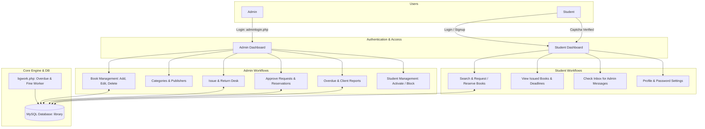

# 📚 Online Library Management System (PHP & MySQL)

[](https://www.php.net/)
[](https://www.mysql.com/)
[](https://getbootstrap.com/)
[]()

A complete web-based **Library Management System (LMS)** developed with **PHP (PDO)** and **MySQL**. It automates cataloging, circulation (book issuing and returning), student account tracking, fine management, overdue tracking, book reservations/requests, and administrative reporting.

---

## 📑 Table of Contents

- [Overview & Architecture](#-overview--architecture)
- [Key Features](#-key-features)
  - [Admin Module](#admin-module)
  - [Student Module](#student-module)
  - [Automation & Fine Engine](#automation--fine-engine)
- [Technology Stack](#-technology-stack)
- [Database Schema & Tables](#-database-schema--tables)
- [Project Directory Structure](#-project-directory-structure)
- [Installation & Setup Guide](#-installation--setup-guide)
- [Default Login Credentials](#-default-login-credentials)
- [Troubleshooting & Tips](#-troubleshooting--tips)
- [License & Contributions](#-license--contributions)

---

## 🏛 Overview & Architecture

The application provides dual-role access control (Admin & Student) with an intuitive interface powered by Bootstrap and DataTables. Database interaction uses **PDO (PHP Data Objects)** with prepared statements to guarantee robust security against SQL injection.



---

## ✨ Key Features

### 🛡 Admin Module
* **Secure Authentication**: Admin dashboard protected by password hashing and session checks.
* **Dashboard Analytics**: Real-time counter metrics for:
  * Total Books Listed
  * Total Times Books Issued
  * Total Books Returned
  * Registered Students
  * Total Authors / Publishers
  * Total Categories
  * Active Fine Rate per Day
* **Book & Stock Management**:
  * Add, edit, and delete books.
  * Real-time stock tracking (`Total Copies`, `Issued Copies`, and computed `Available Copies`).
  * Classification by Category and Publisher/Author with ISBN number and pricing.
* **Category & Author Management**:
  * Add, modify, and delete categories and publishers.
  * Toggle category status (Active / Inactive).
* **Circulation Desk (Issue & Return)**:
  * Fast issuance workflow with dynamic AJAX auto-lookup for Student Name (`get_student.php`) and Book Title (`get_book.php`).
  * Return book management with automated calculation of elapsed return days.
  * Automatic inventory count updates upon issue and return.
* **Request & Reservation Handling**:
  * Review and approve requested books from students.
  * Track reservations for books that are temporarily out of stock.
* **Student Accounts & Access Control**:
  * View complete registered student records.
  * One-click toggle to **Activate** or **Block** student access.
* **Reports & Print Module**:
  * **Overdue Report**: Generates real-time overdue records past return threshold with student contact details and fines, ready for print (`window.print()`).
  * **Client Circulation Report**: Comprehensive log of student borrowing history.
  * **Configurable Fine Rate**: Adjust penalty per day directly via Admin panel (`set-fine.php`).

---

### 🎓 Student Module
* **Registration & ID Generation**:
  * Registration portal (`signup.php`) with real-time AJAX check for existing emails.
  * Automatic student ID numbering system (via tracker `studentid.txt`).
* **Interactive Dashboard**:
  * Overview of issued books and books pending return.
  * Notification panel for messages and return reminders dispatched by the library admin.
* **Catalog Exploration & Book Requesting**:
  * Browse available books and request loans directly online (limited to 2 concurrent requests to prevent hoarding).
  * Auto-reserve books that have zero available copies.
* **Issued Books History**:
  * View issued titles, borrow dates, return dates, return status, and fine penalties.
* **Self-Service Profile Management**:
  * Update mobile number and personal details.
  * Secure password change with verification of old password.

---

### ⚙ Automation & Fine Engine
* **Background Overdue Engine (`bgwork.php`)**:
  * Checks unreturned books against current date.
  * Calculates overdue days past return limit and computes accrued penalty (`Days × FinePerDay`).
  * Persists records in the `overdue` table for admin auditing.
* **Notification System**:
  * Alerts students on their dashboard with personalized return reminders stored in `tblmessage`.

---

## 💻 Technology Stack

| Layer | Technologies / Libraries |
| :--- | :--- |
| **Backend** | PHP 7.4 / 8.x, PDO (PHP Data Objects), Sessions |
| **Database** | MySQL 5.7+ / MariaDB 10.4+ |
| **Frontend** | HTML5, CSS3, JavaScript (ES6) |
| **UI Framework** | Bootstrap 3.3.x, Font Awesome 4.x |
| **Data Tables** | jQuery DataTables (sorting, pagination, live search) |
| **AJAX** | jQuery AJAX for real-time validation & lookups |
| **Security** | Prepared statements (PDO), MD5 hashing, CAPTCHA generator |

---

## 🗄 Database Schema & Tables

The database name is **`library`**. The SQL file is located at [`library.sql`](library.sql).

| Table Name | Description | Key Columns |
| :--- | :--- | :--- |
| `admin` | Admin authentication credentials and metadata | `id`, `FullName`, `AdminEmail`, `UserName`, `Password` |
| `tblstudents` | Registered student profiles and account status | `id`, `StudentId`, `FullName`, `EmailId`, `MobileNumber`, `Password`, `Status` |
| `tblbooks` | Book inventory with stock and catalog info | `id`, `BookName`, `Copies`, `IssuedCopies`, `CatId`, `AuthorId`, `ISBNNumber`, `BookPrice` |
| `tblcategory` | Book genres and category status | `id`, `CategoryName`, `Status`, `CreationDate` |
| `tblauthors` | Authors / publication details | `id`, `AuthorName`, `creationDate` |
| `tblissuedbookdetails` | Circulation history (borrowing and returns) | `id`, `BookId`, `StudentID`, `IssuesDate`, `ReturnDate`, `ReturnStatus`, `fine` |
| `tblbookreservations` | Pre-orders/reservations for out-of-stock titles | `id`, `StudentID`, `BookID`, `RequestDate`, `Status` |
| `tblrequestedbookdetails` | Pending student book loan requests | `StudentID`, `StudName`, `BookName`, `CategoryName`, `AuthorName`, `ISBNNumber`, `BookPrice` |
| `tblfine` | Configurable penalty amount setting per day | `fine` |
| `tblmessage` | Notifications and overdue alerts sent to students | `id`, `StudentID`, `Message`, `SentDate`, `Status` |
| `overdue` | Computed overdue penalty records | `StudentID`, `StudentName`, `MobNumber`, `Fine` |

---

## 📁 Project Directory Structure

```text
├── admin/                           # Admin portal directory
│   ├── assets/                      # Admin CSS, fonts, and JS libraries
│   │   ├── css/                     # Bootstrap, font-awesome, and custom stylesheets
│   │   ├── js/                      # jQuery, Bootstrap, and DataTables scripts
│   │   └── img/                     # Dashboard carousel and UI graphics
│   ├── includes/                    # Shared admin includes
│   │   ├── config.php               # Admin database connection (PDO)
│   │   └── header.php               # Admin navigation bar & header
│   ├── add-book.php                 # Add new book to catalog
│   ├── add-category.php             # Add book category
│   ├── add-publications.php         # Add publisher/author
│   ├── bgwork.php                   # Background overdue calculation worker
│   ├── change-password.php          # Admin password update
│   ├── Clientreport.php             # Printable circulation history report
│   ├── dashboard.php                # Admin KPI dashboard
│   ├── edit-book.php                # Edit existing book record
│   ├── edit-category.php            # Edit category record
│   ├── edit-publication.php         # Edit author/publication record
│   ├── get_book.php                 # AJAX endpoint for fetching book info
│   ├── get_student.php              # AJAX endpoint for fetching student info
│   ├── index.php                    # Admin login page
│   ├── issue-book.php               # Circulation desk: issue book
│   ├── logout.php                   # Terminate admin session
│   ├── manage-books.php             # List, search, and delete books
│   ├── manage-categories.php        # Manage book categories
│   ├── manage-issued-books.php      # View active/past issued records
│   ├── manage-publications.php      # Manage author/publisher list
│   ├── manage-requested-books.php   # Review student book requests
│   ├── overduereport.php            # Printable overdue penalty report
│   ├── reg-students.php             # View and block/activate student accounts
│   ├── report.php                   # Report selector interface
│   ├── set-fine.php                 # Configure fine per day
│   └── update-issue-bookdeails.php  # Process book return & collect fine
│
├── assets/                          # Student & public assets (CSS, JS, Fonts, Images)
├── includes/                        # Shared public includes
│   ├── config.php                   # Main database connection file (PDO)
│   └── header.php                   # Public/Student navigation bar
│
├── adminlogin.php                   # Admin login gateway (root redirect)
├── captcha.php                      # Dynamic CAPTCHA image generator
├── change-password.php              # Student password change page
├── check_availability.php           # AJAX validation for student email
├── dashboard.php                    # Student member dashboard
├── index.php                        # Student login & landing page
├── issued-books.php                 # Student issued books log
├── library.sql                      # Complete MySQL database export
├── logout.php                       # Student session termination
├── my-profile.php                   # Student profile viewing and updating
├── request-a-book.php               # Student catalog browser & request submission
├── signup.php                       # Student registration page
├── studentid.txt                    # Auto-increment student ID tracker
└── temp.php                         # Request validation handler
```

---

## 🚀 Installation & Setup Guide

### 1. Prerequisites
Ensure you have a local web development environment installed:
* [XAMPP](https://www.apachefriends.org/) (Recommended with PHP 7.4 or 8.x) or [WampServer](https://www.wampserver.com/) / [MAMP](https://www.mamp.info/)
* MySQL / MariaDB Server
* Modern Web Browser (Chrome, Firefox, Edge)

---

### 2. Move Project to Web Root
1. Copy or clone the project folder into your web server's document root:
   * **For XAMPP**: `C:/xampp/htdocs/library_management/`
   * **For WAMP**: `C:/wamp64/www/library_management/`

---

### 3. Database Setup
1. Launch **XAMPP Control Panel** and start **Apache** and **MySQL**.
2. Open your browser and navigate to **phpMyAdmin**:
   ```
   http://localhost/phpmyadmin/
   ```
3. Create a new database:
   * **Database Name**: `library`
   * **Collation**: `utf8mb4_general_ci`
4. Click on the newly created `library` database, navigate to the **Import** tab.
5. Choose the [`library.sql`](library.sql) file from the project directory and click **Import** (or **Go**).

---

### 4. Configure Database Credentials
Verify the database connection settings in:
* [`includes/config.php`](includes/config.php)
* [`admin/includes/config.php`](admin/includes/config.php)

Ensure they match your local MySQL configuration:
```php
define('DB_HOST', 'localhost');
define('DB_USER', 'root');
define('DB_PASS', '');       // Default password in XAMPP is blank
define('DB_NAME', 'library');
```

---

### 5. Launch the Application
Open your browser and navigate to:
* **Student Portal / Homepage**:
  ```
  http://localhost/library_management/
  ```
* **Admin Login Portal**:
  ```
  http://localhost/library_management/adminlogin.php
  # or
  http://localhost/library_management/admin/
  ```

---

## 🔑 Default Login Credentials

### 👨‍💼 Administrator
* **URL**: `http://localhost/library_management/adminlogin.php`
* **Username**: `admin`
* **Password**: `Test@123` *(MD5 hash in SQL dump)*

### 👨‍🎓 Demo Student Accounts
* **URL**: `http://localhost/library_management/`
* **Demo Account 1**:
  * **Email**: `divya@gmail.com`
  * **Password**: `12345`
  * **Student ID**: `5`
* **Demo Account 2**:
  * **Email**: `hari@gmail.com`
  * **Password**: `12345`
  * **Student ID**: `6`
* *Or register a new student account at `signup.php`.*

---

## 🛠 Troubleshooting & Tips

> [!TIP]
> **File Permissions (`studentid.txt`)**:
> On Linux/macOS environments, ensure `studentid.txt` has read & write permissions (`chmod 666 studentid.txt`) so new student registrations can increment the ID tracker without errors.

> [!NOTE]
> **Database Host Configuration**:
> If connecting to MySQL on a custom port, update the `DB_HOST` in `config.php`:
> ```php
> define('DB_HOST', '127.0.0.1:3307');
> ```

> [!WARNING]
> **Password Encryption Upgrade Note**:
> The project currently uses `md5()` for educational and prototyping purposes. For high-security production deployments, it is recommended to upgrade to PHP's native `password_hash()` and `password_verify()` using `PASSWORD_BCRYPT` or `PASSWORD_ARGON2ID`.

---

## 📄 License & Attribution

This project is open-source and intended for academic demonstrations, university projects, and library management automation prototypes. Feel free to modify and adapt it to your institution's requirements.
